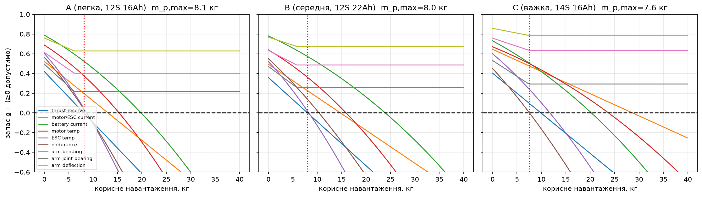
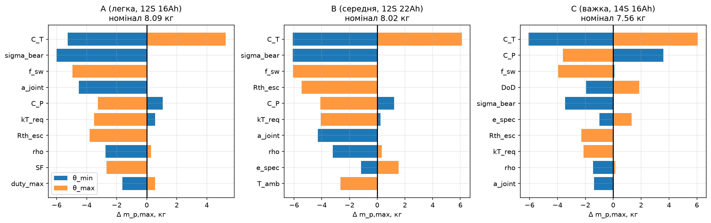
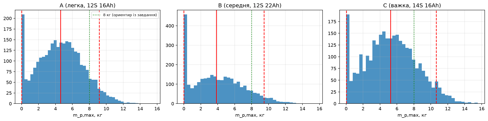
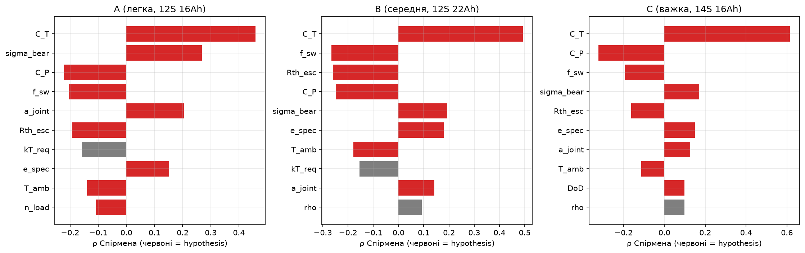
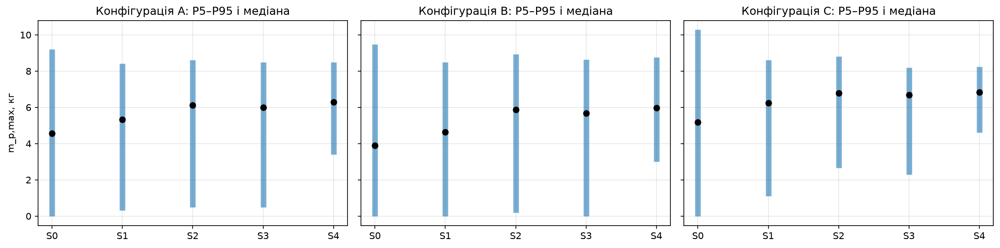

## 1. Мета і постановка задачі

Визначити максимально допустиме додаткове корисне навантаження $m_{p,\max}$ квадрокоптера з чотирма двигунами та пропелерами 22″ за сукупністю механічних, енергетичних, теплових і експлуатаційних обмежень. Вихідних даних не надано, тому всі вхідні величини задані як параметри з діапазонами та статусами `verified` / `requirement` / `hypothesis`. Розглянуто три референсні конфігурації (A легка, B середня, C важка).

Допустимість задається безрозмірними запасами $g_i=1-\text{попит}_i/\text{ресурс}_i\ge 0$ ($i=1\ldots 9$), а граничне навантаження

$$m_{p,\max}=\min_i m_i^*,\qquad g_i(m_i^*,\theta)=0 .$$

Обмеження: запас тяги, струм мотора/ESC, струм батареї, температура мотора, температура ESC, час висіння, вигин променя, зминання під болтами, прогин променя.

## 2. Припущення та граничні умови

| № | Область | Припущення | Наслідок |
|----|------------|----------------------------------------|----------------------------------------|
| A1 | Аеродинаміка | Стаціонарне висіння; C_T, C_P сталі, T=k_T n², Q=k_Q n² | Не враховано швидкість польоту, ефект землі, взаємодію гвинтів, число Рейнольдса |
| A2 | Аеродинаміка | Імпульсна теорія + FoM як контроль; BEMT не застосовано | C_T, C_P залишаються гіпотезами до стендового тесту |
| A3 | Мотор | Лінійна DC-модель: K_t=60/(2πK_v), стале R_m, стале I_0 | Немає насичення, немає залежності R_m від температури |
| A4 | ESC | Втрати P_esc = R_on·I² + f_sw·P_in; макс. шпаруватість 0.95 | Спрощена модель комутації; значення гіпотетичні |
| A5 | Батарея | Стала EMF S·3.7 В, стале R_pack; корисна енергія = S·V_c·Cap·DoD | Без залежності від SoC і температури, без ефекту Пейкерта |
| A6 | Тепло | Стаціонарно: ΔT = P_втрат·R_th, R_th сталий (обдув гвинта) | Не враховано нагрів у часі та вплив температури зовнішнього повітря на R_th |
| A7 | Маса | Вузол мотор+ESC+гвинт на кінці променя; центральне тіло як куля; ЦМ у центрі | Зсув ЦМ від вантажу не враховано; інерція наближена |
| A8 | Механіка | Промінь = консоль; сила T_d=min(n_load·m·g/N, T_max) + реактивний момент; ізотропний матеріал E_eff | Немає удару, втоми, вібрацій, власних частот, втрати стійкості |
| A9 | Механіка | Стик: пара болтів, момент як пара сил, зминання стінки труби | Не розглядається зріз болта, відшарування, дефекти укладки |
| A10 | Невизначеність | Параметри незалежні, трикутні розподіли [min, номінал, max] | Діапазони експертні, не з вимірювань; кореляції (K_v–R_m) не враховано |
| A11 | Вимоги | t_req = 10 хв, k_T = 1.8, SF = 1.5 (вимоги місії) | ЗАДАЄТЬСЯ ЗАМОВНИКОМ; зміна вимог змінює обмежувальний фактор |
| A12 | Середовище | ISA на рівні моря (ρ=1.225, діапазон 1.0–1.25), T_amb=25 °C (−10…40), без вітру | Спека/висота зменшують тягу і запас |
| A13 | Розв’язок | m_p,max = min m_i*; залежність від m через повну масу; перше порушення на сітці | Обмеження незалежні; теплова взаємодія мотор↔батарея спрощена |
| A14 | Корисне навантаження | Точкова маса в центрі, без зсуву ЦМ | Реальне розташування вантажу змінює моменти і керованість (не оцінено) |

**Область застосовності**

| Величина | Діапазон / умова | Примітка |
|----------------------|------------------------------------|------------------------------|
| Корисне навантаження m_p | 0 – 40 кг (сітка 161 точка) | вище не досліджується |
| Режим | стаціонарне висіння | маневр лише через n_load у механіці |
| Геометрія | 4 ротори, X-схема, D = 22″ = 0.5588 м | фіксовано завданням |
| Живлення | 12S або 14S, ємність 16–22 Аг | задано конфігураціями A, B, C |
| Щільність повітря | 1.0 – 1.25 кг/м³ | рівень моря … спека/висота ≈ 2 км |
| Температура середовища | −10 … 40 °C | вплив на батарею не моделюється |
| Промінь (механіка) | затиснутий у центрі, сила на вільному кінці | без контакту із землею |
| Monte Carlo | N = 3000 (1500 у сценаріях), seed = 42 | трикутні незалежні розподіли |

## 3. Модель

Маса: $m_{arm}=\rho_{cf}\tfrac{\pi}{4}(d_o^2-d_i^2)L$, $m_{batt}=S V_c Cap/e_{spec}$. Пропелер: $T=k_Tn^2$, $Q=k_Qn^2$, $k_T=C_T\rho D^4$, $k_Q=C_P\rho D^5/2\pi$. Мотор: $K_t=60/(2\pi K_v)$, $I=Q/K_t+I_0$, $V_m=IR_m+60n/K_v$. ESC: $P_{esc}=R_{on}I^2+f_{sw}P_{in}$. Батарея: $P_{bat}=N(P_{in}+P_{esc})+P_{av}$, $V=\big(V_{oc}+\sqrt{V_{oc}^2-4R_{pack}P_{bat}}\big)/2$, $I_{bat}=P_{bat}/V$. Час висіння: $t=60\,S V_c Cap\,DoD/P_{bat}$ (хв).

Механіка променя: $T_d=\min(n_{load}mg/N,\,T_{max})$, $Q_d=T_dk_Q/k_T$, $M=\sqrt{(T_dL)^2+Q_d^2}$, $\sigma=M(d_o/2)/I_y$, $\sigma_b=M/(a\,n_{pairs})/(d_{bolt}\cdot 2t)$, $\delta=T_dL^3/(3EI_y)$. Розв'язок: сітка по $m_p$ + `brentq`, перевірка власною бісекцією.

## 4. Результати за номінальними параметрами

Граничне навантаження $m_i^*$, кг (— означає, що обмеження не діє до 40 кг):

| index | A (легка, 12S 16Ah) | B (середня, 12S 22Ah) | C (важка, 14S 16Ah) |
|----------------------|--------------|--------------|--------------|
| thrust reserve | 8.09 | 8.02 | 9.90 |
| motor/ESC current | 13.04 | 14.74 | 28.66 |
| battery current | 19.83 | 23.94 | 20.24 |
| motor temp | 15.31 | 15.91 | 23.75 |
| ESC temp | 8.69 | 8.26 | 11.74 |
| endurance | 8.64 | 10.35 | 7.56 |
| arm bending | — | — | — |
| arm joint bearing | — | — | — |
| arm deflection | — | — | — |

- **A (легка, 12S 16Ah):** $m_{p,\max}$ = 8.09 кг, обмежує *thrust reserve*; $m_{порожня}$ = 11.2 кг; $T_{max}$ = 85 Н/ротор (8.7 кгс); FoM = 0.58.
- **B (середня, 12S 22Ah):** $m_{p,\max}$ = 8.02 кг, обмежує *thrust reserve*; $m_{порожня}$ = 14.4 кг; $T_{max}$ = 99 Н/ротор (10.1 кгс); FoM = 0.58.
- **C (важка, 14S 16Ah):** $m_{p,\max}$ = 7.56 кг, обмежує *endurance*; $m_{порожня}$ = 14.7 кг; $T_{max}$ = 109 Н/ротор (11.1 кгс); FoM = 0.58.

{width=100%}

Обмеження 7–9 (механіка) не залежать від $m_p$ вище порога, бо розрахункова тяга обмежена $T_{max}$ двигунів: за прийнятою моделлю міцність променів не обмежує навантаження.

## 5. Аналіз чутливості (OAT)

**A (легка, 12S 16Ah)** (номінал 8.09 кг), найвпливовіші параметри:

| param | status | m_lo | m_hi | swing |
|----------------|--------------|----------|----------|----------|
| C_T | hypothesis | 2.83 | 13.36 | 10.53 |
| sigma_bear | hypothesis | 2.09 | 8.09 | 6.00 |
| f_sw | hypothesis | 8.09 | 3.15 | 4.94 |
| a_joint | hypothesis | 3.57 | 8.09 | 4.52 |
| C_P | hypothesis | 9.16 | 4.85 | 4.31 |
| kT_req | requirement | 8.64 | 4.58 | 4.06 |

**B (середня, 12S 22Ah)** (номінал 8.02 кг), найвпливовіші параметри:

| param | status | m_lo | m_hi | swing |
|----------------|--------------|----------|----------|----------|
| C_T | hypothesis | 1.92 | 14.12 | 12.20 |
| sigma_bear | hypothesis | 1.92 | 8.02 | 6.10 |
| f_sw | hypothesis | 8.02 | 1.95 | 6.07 |
| Rth_esc | hypothesis | 8.02 | 2.58 | 5.44 |
| C_P | hypothesis | 9.24 | 3.91 | 5.33 |
| kT_req | requirement | 8.26 | 3.95 | 4.31 |

**C (важка, 14S 16Ah)** (номінал 7.56 кг), найвпливовіші параметри:

| param | status | m_lo | m_hi | swing |
|----------------|--------------|----------|----------|----------|
| C_T | hypothesis | 1.49 | 13.62 | 12.13 |
| C_P | hypothesis | 11.15 | 3.95 | 7.20 |
| f_sw | hypothesis | 7.63 | 3.61 | 4.02 |
| DoD | hypothesis | 5.60 | 9.43 | 3.83 |
| sigma_bear | hypothesis | 4.10 | 7.56 | 3.45 |
| e_spec | hypothesis | 6.57 | 8.87 | 2.30 |

{width=100%}

## 6. Невизначеність (Monte Carlo)

Змінні параметри семплюються з трикутних розподілів $\mathrm{Tri}(\theta_{\min},\theta_{nom},\theta_{\max})$, $N=3000$, `seed=42`.

| config | N | P(=0) | P5 | P50 | P95 | P5⁺ | P50⁺ | P95⁺ | P(≥5) | P(≥8) |
|----------------------|------|--------|------|------|------|-------|-------|-------|-------|-------|
| A (легка, 12S 16Ah) | 3000 | 0.06 | 0.00 | 4.59 | 9.17 | 0.97 | 4.80 | 9.26 | 0.44 | 0.11 |
| B (середня, 12S 22Ah) | 3000 | 0.13 | 0.00 | 3.85 | 9.45 | 0.61 | 4.44 | 9.71 | 0.37 | 0.11 |
| C (важка, 14S 16Ah) | 3000 | 0.05 | 0.03 | 5.25 | 10.64 | 1.06 | 5.43 | 10.72 | 0.53 | 0.19 |

Позначення: P5, P50, P95 це процентилі $m_{p,\max}$, кг; P(=0), P(≥5), P(≥8) це частки вибірок; ⁺ означає умовну оцінку для вибірок з $m_{p,\max}>0$.

`P(m_p=0)` це частка вибірок, де обмеження порушене вже без вантажу (переважно зминання під болтами за низького $\sigma_{bear}$), тобто дефект проєкту за цих параметрів. Умовні оцінки `P5|m>0 … P95|m>0` стосуються життєздатних проєктів. Номінал лежить у верхній частині розподілу, бо $m_{p,\max}$ є мінімумом кількох невизначених обмежень.

{width=100%}

{width=100%}

## 7. Верифікація обчислень

**Розмірності (`pint`):** усі ключові формули повторно обчислені з одиницями; негативний тест (навмисна помилка $D^5$ у формулі тяги) **виявлено**.

| конф. | величин | відн. розбіжн. | макс. Δg | розм. |
|--------|----------|----------------|--------------|--------|
| A | 41 | 1.1e-16 | 1.1e-16 | ✔ |
| B | 41 | 2.2e-16 | 8.9e-16 | ✔ |
| C | 41 | 2.2e-16 | 1.1e-16 | ✔ |

**Збіжність по кроку сітки** ($m_{p,\max}$, кг):

| index | A (легка, 12S 16Ah) | B (середня, 12S 22Ah) | C (важка, 14S 16Ah) |
|--------------|----------------------|----------------------|----------------------|
| сітка 21 | 8.09 | 8.02 | 7.56 |
| сітка 41 | 8.09 | 8.02 | 7.56 |
| сітка 81 | 8.09 | 8.02 | 7.56 |
| сітка 161 | 8.09 | 8.02 | 7.56 |
| сітка 321 | 8.09 | 8.02 | 7.56 |

**Порівняння методів пошуку кореня** (`brentq` vs бісекція):

| config | max_abs_diff_кг | iter_бісекції |
|------------------------|----------------|--------------|
| A (легка, 12S 16Ah) | 0.00 | 18 |
| B (середня, 12S 22Ah) | 0.00 | 18 |
| C (важка, 14S 16Ah) | 0.00 | 18 |

## 8. Достовірність результатів

### 8.1 Автоматичний аудит

#### A (легка, 12S 16Ah)
- **Розрахункова оцінка (номінал):** 8.1 кг, обмежує: *thrust reserve*
- **Діапазон невизначеності Monte Carlo (P5–P95):** 0.0 – 9.2 кг, медіана 4.6 кг
- **Частка вибірок з m_p=0 (конструкція/режим недопустимі без вантажу):** 6%; для решти P5–P95 = 1.0 – 9.3 кг
- **Склад параметрів:** verified 12, requirement 4, hypothesis 35. Експериментально підтверджених: 0
- **Домінують у невизначеності:** `C_T` (ρ=+0.46, hypothesis), `sigma_bear` (ρ=+0.27, hypothesis), `C_P` (ρ=-0.22, hypothesis), `f_sw` (ρ=-0.20, hypothesis), `a_joint` (ρ=+0.20, hypothesis)
- **З них гіпотези:** 5 з 5 → результат **не можна вважати підтвердженим** без вимірювання цих величин
- **Внутрішні перевірки:** ✔ Баланс тяги 4T = m g; ✔ P_in ≥ P_вал (енергія); ✔ FoM у діапазоні 0.4–0.75; ✔ Збіг brentq/бісекція < 1e-4 кг; ✔ Шпаруватість у висінні < 0.85; ✔ Розмірності (pint) і збіг з unit-aware формулами
- **Попередження / суперечності:** пікове споживання 199 А > довготривалого C-рейтингу 160 А (допустимо лише короткочасно); струм при макс. тязі 50 А > довготривалого рейтингу мотора/ESC (допустимо лише як пік); механіка не обмежує: результат визначають електрика/тяга/час (див. застереження про навантаження)

#### B (середня, 12S 22Ah)
- **Розрахункова оцінка (номінал):** 8.0 кг, обмежує: *thrust reserve*
- **Діапазон невизначеності Monte Carlo (P5–P95):** 0.0 – 9.4 кг, медіана 3.8 кг
- **Частка вибірок з m_p=0 (конструкція/режим недопустимі без вантажу):** 13%; для решти P5–P95 = 0.6 – 9.7 кг
- **Склад параметрів:** verified 12, requirement 4, hypothesis 35. Експериментально підтверджених: 0
- **Домінують у невизначеності:** `C_T` (ρ=+0.49, hypothesis), `f_sw` (ρ=-0.27, hypothesis), `Rth_esc` (ρ=-0.26, hypothesis), `C_P` (ρ=-0.25, hypothesis), `sigma_bear` (ρ=+0.19, hypothesis)
- **З них гіпотези:** 5 з 5 → результат **не можна вважати підтвердженим** без вимірювання цих величин
- **Внутрішні перевірки:** ✔ Баланс тяги 4T = m g; ✔ P_in ≥ P_вал (енергія); ✔ FoM у діапазоні 0.4–0.75; ✔ Збіг brentq/бісекція < 1e-4 кг; ✔ Шпаруватість у висінні < 0.85; ✔ Розмірності (pint) і збіг з unit-aware формулами
- **Попередження / суперечності:** пікове споживання 247 А > довготривалого C-рейтингу 220 А (допустимо лише короткочасно); струм при макс. тязі 62 А > довготривалого рейтингу мотора/ESC (допустимо лише як пік); механіка не обмежує: результат визначають електрика/тяга/час (див. застереження про навантаження)

#### C (важка, 14S 16Ah)
- **Розрахункова оцінка (номінал):** 7.6 кг, обмежує: *endurance*
- **Діапазон невизначеності Monte Carlo (P5–P95):** 0.0 – 10.6 кг, медіана 5.2 кг
- **Частка вибірок з m_p=0 (конструкція/режим недопустимі без вантажу):** 5%; для решти P5–P95 = 1.1 – 10.7 кг
- **Склад параметрів:** verified 12, requirement 4, hypothesis 35. Експериментально підтверджених: 0
- **Домінують у невизначеності:** `C_T` (ρ=+0.62, hypothesis), `C_P` (ρ=-0.32, hypothesis), `f_sw` (ρ=-0.19, hypothesis), `sigma_bear` (ρ=+0.17, hypothesis), `Rth_esc` (ρ=-0.16, hypothesis)
- **З них гіпотези:** 5 з 5 → результат **не можна вважати підтвердженим** без вимірювання цих величин
- **Внутрішні перевірки:** ✔ Баланс тяги 4T = m g; ✔ P_in ≥ P_вал (енергія); ✔ FoM у діапазоні 0.4–0.75; ✔ Збіг brentq/бісекція < 1e-4 кг; ✔ Шпаруватість у висінні < 0.85; ✔ Розмірності (pint) і збіг з unit-aware формулами
- **Попередження / суперечності:** пікове споживання 245 А > довготривалого C-рейтингу 160 А (допустимо лише короткочасно); струм при макс. тязі 61 А > довготривалого рейтингу мотора/ESC (допустимо лише як пік); механіка не обмежує: результат визначають електрика/тяга/час (див. застереження про навантаження)

#### Класифікація результатів
| Клас | Що сюди входить |
|---|---|
| Підтверджено експериментом | немає |
| Розрахункові оцінки | m_p,max (номінал), діапазон P5–P95, обмежувальний фактор, ранжування чутливості |
| Гіпотези | C_T, C_P, Kv, R_m, I_0, R_pack, e_spec, теплові опори, σ_all, E, n_load та ін. (статус `hypothesis`) |

### 8.2 Вплив вимірювань на невизначеність

| сценарій | конф. | P5 | P50 | P95 | ширина | P(=0) |
|------------------------|--------|--------|--------|--------|----------|--------|
| S0 зараз | A | 0.00 | 4.56 | 9.19 | 2.02 | 0.06 |
| S0 зараз | B | 0.00 | 3.89 | 9.47 | 2.43 | 0.12 |
| S0 зараз | C | 0.00 | 5.18 | 10.28 | 1.99 | 0.05 |
| S1 + стенд | A | 0.32 | 5.33 | 8.41 | 1.52 | 0.04 |
| S1 + стенд | B | 0.00 | 4.63 | 8.50 | 1.84 | 0.07 |
| S1 + стенд | C | 1.10 | 6.24 | 8.62 | 1.21 | 0.03 |
| S2 + ESC/тепло | A | 0.49 | 6.12 | 8.62 | 1.33 | 0.04 |
| S2 + ESC/тепло | B | 0.20 | 5.87 | 8.93 | 1.49 | 0.05 |
| S2 + ESC/тепло | C | 2.66 | 6.79 | 8.80 | 0.90 | 0.02 |
| S3 + батарея | A | 0.49 | 5.99 | 8.49 | 1.34 | 0.04 |
| S3 + батарея | B | 0.00 | 5.68 | 8.63 | 1.52 | 0.05 |
| S3 + батарея | C | 2.29 | 6.68 | 8.20 | 0.89 | 0.02 |
| S4 + стик/матеріал | A | 3.41 | 6.28 | 8.49 | 0.81 | 0.00 |
| S4 + стик/матеріал | B | 3.02 | 5.97 | 8.75 | 0.96 | 0.00 |
| S4 + стик/матеріал | C | 4.61 | 6.82 | 8.24 | 0.53 | 0.00 |

Ширина = (P95−P5)/P50. Конфігурації: A, B, C.

{width=100%}

### 8.3 Умови достовірності (K1–K5)

Результат вважається достовірним лише коли виконано **всі** критерії: K1 усі 5 найчутливіших параметрів виміряні; K2 $(P95-P5)/P50\le 0.5$; K3 пройдені внутрішні перевірки; K4 пройдена перевірка розмірностей; K5 розбіжність модель/стенд ≤ 10%.

| конфігурація | K1 | K2 | K3 | K4 | K5 | verdict |
|------------------------|------------------|------------------------|------|------|------------------|----------------------|
| A (легка, 12S 16Ah) | ✘ (0/5 виміряно) | ✘ зараз 2.02; після S4 0.81 | ✔ | ✔ | ✘ немає стендових даних | НЕ підтверджений (2/5 критеріїв) |
| B (середня, 12S 22Ah) | ✘ (0/5 виміряно) | ✘ зараз 2.43; після S4 0.96 | ✔ | ✔ | ✘ немає стендових даних | НЕ підтверджений (2/5 критеріїв) |
| C (важка, 14S 16Ah) | ✘ (0/5 виміряно) | ✘ зараз 1.99; після S4 0.53 | ✔ | ✔ | ✘ немає стендових даних | НЕ підтверджений (2/5 критеріїв) |

**Поточний висновок:** жодну з конфігурацій не можна вважати підтвердженою; всі наведені значення це розрахункові оцінки на гіпотетичних даних. Експериментально підтверджених результатів немає.

## 9. Перелік експериментів і межі моделі

**Експерименти (у порядку впливу на невизначеність) і критерії прийнятності:**

| № | Експеримент | Параметри, що уточнюються | Критерій прийнятності |
|--|-------------|-------------------|--------------|
| 1 | Стенд: тяга, потужність, обороти, струм (мотор + 22″ гвинт + ESC, кілька напруг) | $C_T$, $C_P$, $K_v$, $R_m$, $I_0$, $T_{max}$ | $C_T$, $C_P$ ±5%, $K_v$ ±3%; збіг $T$ і $P_{el}$ з моделлю ≤ 10% у діапазоні 50–100% газу |
| 2 | Розрядна крива батареї під навантаженням | $R_{pack}$, $e_{spec}$, $DoD$ | $R_{pack}$ ±10%, використана енергія ±5% |
| 3 | Тепловий тест висіння з вантажем (термопара, тепловізор) | $R_{th,m}$, $R_{th,esc}$, $f_{sw}$, $R_{on}$ | $R_{th}$ ±10%; пікова температура модель/вимір ≤ 10 К |
| 4 | Статичний тест променя і стику до 1.5·$T_{max}$ (тензодатчики, прогин) | $E$, $\sigma_{all}$, $\sigma_{bear}$, $a_{joint}$ | $E$ ±8%, $\sigma_{bear}$ ±8%; прогин модель/вимір ≤ 15% |
| 5 | Зважування компонентів, положення ЦМ | $m_{motor}$, $m_{esc}$, $m_{prop}$, $m_{plate}$, $m_{av}$, $m_{misc}$ | маса ±2%, ЦМ ±5 мм |
| 6 | Підтвердження: висіння з $m_p=0.8\,m_{p,\max}$ | час, струм, температури | час висіння ±10% від моделі, без перегріву |

**Межі достовірності моделі:**

- Імпульсна теорія зі стаціонарними $C_T,C_P$: без впливу швидкості польоту, взаємодії гвинтів, ефекту землі.
- Мотор: лінійна DC-модель; ESC: спрощені втрати; батарея: постійний опір без залежності від SoC і температури.
- Механіка: статична консоль при максимальній тязі; **не враховано** удар, втому, вібрації, власні частоти, втрату стійкості, центральну пластину і шасі.
- Monte Carlo: незалежні трикутні розподіли з експертними діапазонами; кореляції не враховано.
- Вимога часу висіння $t_{req}=10$ хв задана умовно.
- Перевірка розмірностей охоплює формули моделі, але не гарантує правильності самих фізичних припущень.

**Не реалізовано (можливі наступні кроки):** BEMT для пропелера, МСЕ для вузла кріплення, варіація геометрії променя, обмеження керованості (запас моменту), власні частоти, кореляції параметрів, індекси Соболя.
